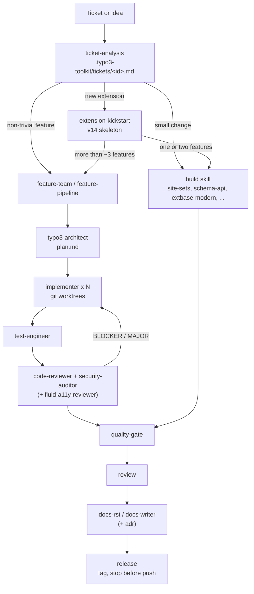

# Architecture

The plugin is built in four layers. Each layer has one job and talks to the
next through a small, fixed contract.

## Layers

| Layer | Lives in | Job | Contract with the next layer |
| --- | --- | --- | --- |
| Skills | `skills/<name>/SKILL.md` (+ `references/`, `templates/`) | Knowledge and procedure for one task: the TYPO3 concept, the steps, a checklist, a report format | Name the agent to delegate to and what to pass it |
| Agents | `agents/<name>.md` | A focused worker with its own model, tool set and context window | A fixed reply format the caller can parse and merge |
| Hooks | `hooks/hooks.json`, `hooks/scripts/*.sh`, `hooks/register.ts` | Deterministic guard rails and context around every tool call, independent of what the model decides | JSON on stdout (`permissionDecision`, `additionalContext`, `decision: block`) |
| Workflows | `workflows/*.js` | Deterministic, resumable orchestration of several agents with structured output | A JSON result object |

Supporting parts: `bin/` (`t3`, `t3-changelog` on the Bash `PATH`),
`monitors/` (TYPO3 log streaming during the gate), `output-styles/`,
`.lsp.json`, `.mcp.json`, `settings.json` (subagent status line) and
`evals/`.

## Source of truth: the core changelog

Every TYPO3 claim in the plugin cites a core changelog entry
(`Feature-<id>`, `Breaking-<id>`, `Deprecation-<id>`, `Important-<id>`).
The entries are read, not recalled:

- `bin/t3-changelog <id|issue|keyword>` prints the rst. It searches
  `vendor/typo3/cms-core/Documentation/Changelog`, then classic-mode core
  paths, then a sparse clone of `TYPO3/typo3` cached in
  `~/.cache/typo3-extension-migration/typo3-core` (refreshed at most once a
  day, shared with the sister migration plugins).
- The `changelog-researcher` agent answers only from those files.
- `scripts/selftest.sh` fails when a cited ID has no rst in the cache.

The version folder of an rst (`13.1`, `14.2`) is the version that
introduced the change. That is how skills state availability on 13.4.

## Model routing

| Model | Agents | Why |
| --- | --- | --- |
| Haiku | `code-scout`, `changelog-researcher`, `ci-watcher` (and the `explain-change` skill) | Sweeps and lookups: many cheap, narrow calls |
| Sonnet | `implementer`, `test-engineer`, `docs-writer`, `fluid-a11y-reviewer` | Building and template review: good code at moderate cost |
| Opus (`effort: high`) | `typo3-architect`, `code-reviewer`, `security-auditor` | Planning and adversarial judgement, where a miss is expensive |

Read-only agents carry `disallowedTools: Write, Edit`. The architect may
write, but only `.typo3-toolkit/plan.md`.

## The plan contract

`typo3-architect` writes `.typo3-toolkit/plan.md` with exactly these
sections:

```markdown
# Plan: <feature>

## Context
## Packages
### P1 <name>
- Files: <exact paths, new files marked (new)>
- Skill: <build skill>
- Steps: <numbered, concrete>
- Proof: <command>
- Depends on: <none | P-ids>
## Tests
## Risks and decisions
```

Rules that make parallel work safe:

- Packages have **disjoint file sets**. Two packages never touch the same
  file.
- Shared registration files (`ext_localconf.php`,
  `Configuration/Services.yaml`, `composer.json`,
  `Configuration/Sets/*/config.yaml`) belong to one **wiring** package that
  runs last.
- Every package names a **proof command** (`php -l` plus the narrowest
  PHPStan or PHPUnit run).
- Three to six packages is normal. Open questions go under "Risks and
  decisions", and the orchestrator stops for the user when there are any.

## Worktree isolation

`implementer` declares `isolation: worktree`, so each instance works in its
own git worktree on its own branch. It edits only its file set, reports
changes it needs elsewhere as `NEEDS-OUTSIDE`, and finishes with one
`[WIP] <id> <name>` commit. The orchestrator merges the branches with
`git merge --no-ff` in plan order. A merge conflict means the plan was
wrong (the sets were not disjoint), so it goes back to the architect rather
than being resolved by guessing.

The workflow script integrates with a `general-purpose` agent on purpose:
the `implementer` definition forces a worktree, and integration must happen
in the main tree.

## Reply formats

Every agent ends with a fixed, line-oriented block, for example:

```text
PACKAGE  P2 Teaser component
WORKTREE ../wt-p2 (branch wt/p2)
CHANGED  Resources/Private/Components/TeaserCard/TeaserCard.fluid.html | new component
NEEDS-OUTSIDE Configuration/Fluid/ComponentCollections.php | register Acme\Events\Components
PROOF    vendor/bin/typo3 fluid:analyze -> exit 0 (0 errors)
```

The keys (`VERDICT`, `BLOCKER`, `HIT`, `FINDING`, `RUN`, ...) let the
orchestrator merge results from parallel agents without re-reading them.
Workflows map the same content onto JSON schemas. All formats are listed in
[agents.md](agents.md).

## Hooks around every step

Hooks run regardless of which skill or agent is active:

- `SessionStart` and `FileChanged` (`composer.lock`) tell the model which
  TYPO3 version and mode it is in.
- `PreToolUse` guards deny or ask before dangerous Bash commands and edits
  of generated files.
- `PostToolUse` lints PHP and flags legacy APIs right after an edit.
- `Stop` asks for a test or gate run when code changed without one.

Details in [hooks.md](hooks.md).

## End-to-end lifecycle



| Stage | Component | Output | Gate to the next stage |
| --- | --- | --- | --- |
| Understand | `ticket-analysis` | `.typo3-toolkit/tickets/<id>.md` | Questions for the reporter answered or accepted as assumptions |
| Scaffold (new extensions) | `extension-kickstart` | Extension skeleton, `composer validate` clean | `quality-gate --fast` |
| Plan | `typo3-architect` | `.typo3-toolkit/plan.md` | No open decisions |
| Build | `implementer` agents or a build skill | Commits per package | Proof command exits 0 |
| Test | `test-engineer` / `functional-tests` | Tests under `Tests/` | Suites exit 0 |
| Review | `code-reviewer`, `security-auditor`, `fluid-a11y-reviewer` | Findings | No BLOCKER or MAJOR (max three fix rounds) |
| Verify | `quality-gate` | Per-step verdict | `PASSED` |
| Document | `docs-rst`, `docs-writer`, `adr` | `Documentation/` | Render with zero warnings |
| Release | `release` | Version bump, CHANGELOG, local tag | Explicit "yes" before any push or upload |

Each stage can be used on its own; the lifecycle is a recommendation, not a
requirement.
